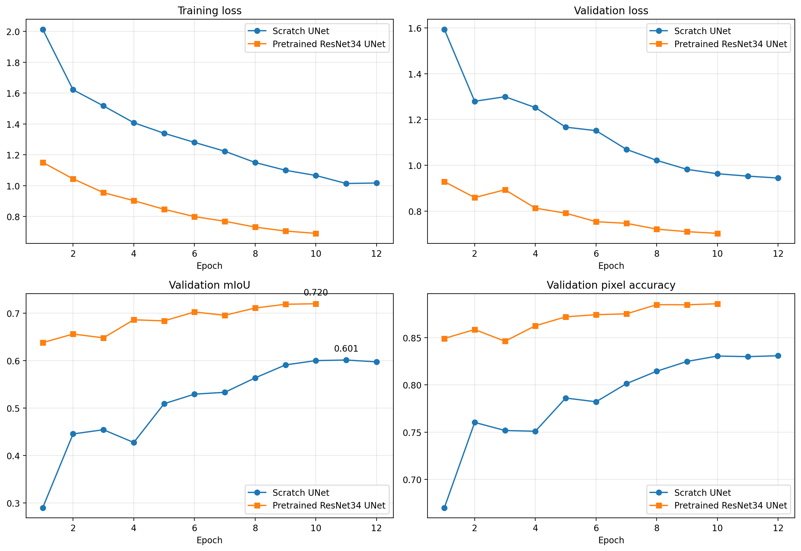
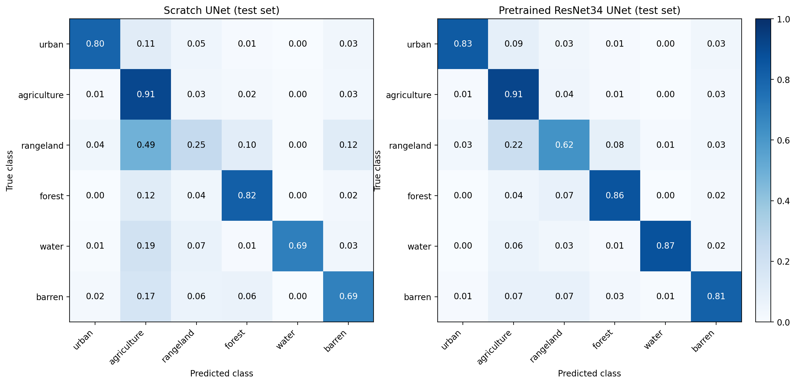
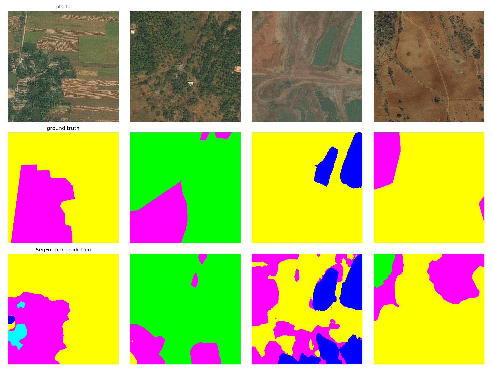
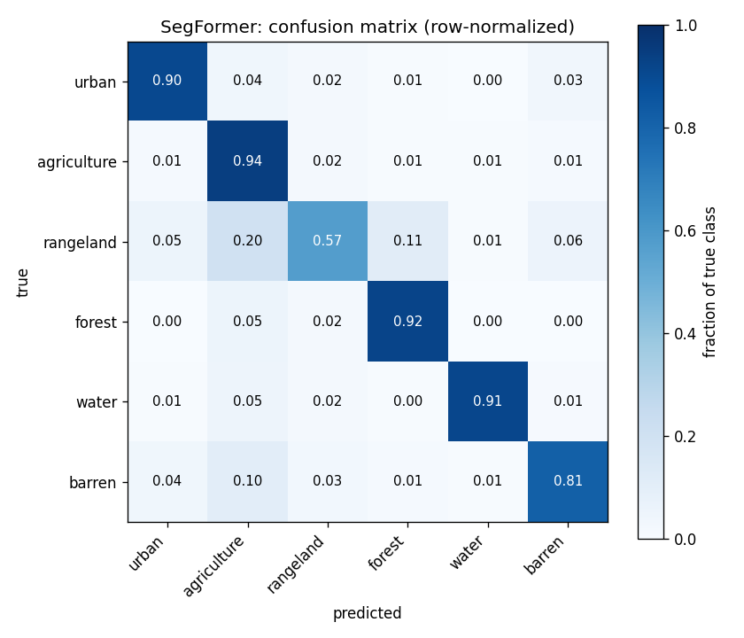

# Land Cover Segmentation on DeepGlobe: UNet vs. SegFormer

Satellite imagery segmented pixel-by-pixel into six land cover classes, comparing three approaches on the exact same data: a UNet built from scratch, a UNet with a pretrained ResNet34 encoder, and SegFormer (a transformer-based model) fine-tuned from ImageNet weights.

The headline result: **SegFormer wins on every axis measured, accuracy, model size, and inference speed, while being the smallest of the three models.**

## Why this project

Land cover maps are used to track deforestation, monitor agriculture, plan cities, and respond to natural disasters. Doing this by hand doesn't scale; this project automates it, and uses the task as a controlled comparison between a convolutional architecture and a transformer architecture under identical conditions.

## Dataset

[DeepGlobe Land Cover Classification](https://www.kaggle.com/datasets/balraj98/deepglobe-land-cover-classification-dataset) 803 labelled satellite images at 2448×2448 resolution, 6 land cover classes plus an ignored "unknown" class.

| Class | Share of pixels (train) |
|---|---|
| Agriculture | 56.96% |
| Forest | 11.60% |
| Urban | 11.04% |
| Rangeland | 8.58% |
| Barren | 8.11% |
| Water | 3.71% |

**Preprocessing pipeline** (shared across all three models, for a fair comparison):
- Images split 70/15/15 (train/val/test) **by source image**, before tiling, to prevent data leakage between neighbouring tiles of the same photo.
- Each 2448×2448 image cut into a 4×4 grid of 612×612 tiles.
- Training uses a random 512×512 crop of each tile plus flips, 90° rotations, and brightness/contrast jitter. Validation and test use a fixed center 512×512 crop.
- All models normalized with ImageNet mean/std, so pretrained encoders stay meaningful.

## Models

### 1. UNet from scratch
Every encoder/decoder block implemented directly in PyTorch, including the skip connections that let the decoder recover fine spatial detail the encoder's pooling discards. No pretraining; learns entirely from the ~9,000 training tiles.

### 2. UNet with a pretrained ResNet34 encoder
Same decoder design, but the encoder starts from ImageNet-pretrained weights instead of random initialization, isolating the effect of transfer learning while holding the architecture family constant.

### 3. SegFormer (NVIDIA `mit-b0`)
A transformer-based model with a hierarchical encoder (self-attention instead of convolutions) and a deliberately lightweight all-MLP decode head. Fine-tuned from an ImageNet-pretrained encoder, with discriminative learning rates (encoder trained more gently than the newly-initialized head).

All three were trained with a combined CrossEntropy + Dice loss (to counter class imbalance), mixed precision, and a `OneCycleLR` schedule.

## Results (held-out test set, never used for training or model selection)

| Model | Parameters | Weights file | Inference (ms / batch of 8) | Test mIoU | Test pixel acc |
|---|---|---|---|---|---|
| Scratch UNet | 7.8 M | 31.1 MB | 94.7 ms | 0.5698 | 0.8050 |
| Pretrained ResNet34 UNet | 24.4 M | 97.9 MB | 67.0 ms | 0.6913 | 0.8642 |
| **SegFormer (mit-b0)** | **3.7 M** | **15.0 MB** | **62.5 ms** | **0.7101** | **0.8751** |

### Per-class IoU (test set)

| Class | Scratch UNet | Pretrained UNet | SegFormer |
|---|---|---|---|
| Urban | 0.724 | 0.767 | **0.784** |
| Agriculture | 0.793 | 0.855 | **0.875** |
| Rangeland | 0.179 | 0.417 | **0.451** |
| Forest | 0.638 | **0.736** | 0.731 |
| Water | 0.562 | 0.715 | **0.725** |
| Barren | 0.522 | 0.658 | **0.695** |

SegFormer leads on 5 of 6 classes; forest is a near-tie with the pretrained UNet.

## Key finding: rangeland is a hard, systemic limit, not a model-specific weakness

Rangeland is the lowest-scoring class for **every single model**, and the gap is large:

```
Scratch UNet (no pretraining):       0.179
Pretrained ResNet34 UNet:            0.417   (+0.238 from pretraining alone)
SegFormer:                           0.451   (+0.034 further, from the transformer)
```

The confusion matrix shows why: rangeland pixels are most often confused with agriculture (20% of true rangeland pixels, in SegFormer's case), with smaller leaks to forest and barren. Visually, rangeland sits between farmland, forest, and bare ground with no sharp natural boundary, and this ambiguity shows up in the source labels themselves (a tree-lined field edge, for instance, was labelled rangeland rather than forest in one inspected tile).

The fact that this pattern holds across three architecturally very different models, with pretraining providing by far the largest single improvement, suggests this is a property of the dataset's class definitions, not something a bigger model or more training would resolve.

## Visuals

**UNet: training curves (scratch vs. pretrained)**


**UNet: confusion matrices, both variants, test set**


**SegFormer: predictions vs. ground truth**


**SegFormer: confusion matrix, test set**


## Repository structure

```
notebook/
├── unet-model-comparison.ipynb   scratch UNet + pretrained ResNet34 UNet, trained and evaluated side by side
└── segformer.ipynb                SegFormer (mit-b0), trained and evaluated independently
results/      per-class metrics, model facts, and the combined comparison table, as CSV/JSON
figures/      training curves, confusion matrices, and side-by-side prediction visualizations
split.json    the train/val/test split (by source image), shared by every model for a fair comparison
```

## Reproducing this

1. `unet-model-comparison.ipynb` builds the tiled dataset and the 70/15/15 train/val/test split (by source image, to avoid leakage between tiles of the same photo), trains both UNet variants, and evaluates them on the held-out test set. The tiled data should be saved as a reusable dataset (e.g. a Kaggle Dataset) so it can be reattached rather than rebuilt.
2. `segformer.ipynb` attaches that same prepared dataset and `split.json`, then trains and evaluates SegFormer independently, no dependency on the UNet notebook having run first, beyond the shared tiles and split.
3. All models use identical evaluation code (`SegMetrics`, the same test split) so results are directly comparable.

## Limitations

- Single run per model, one random seed; small score differences (under ~1 point of mIoU) shouldn't be treated as conclusive without repeated runs.
- Labels are human-annotated and coarse at object boundaries, which caps achievable accuracy regardless of model quality.
- SegFormer and the UNets were trained for the same number of epochs for comparability, not necessarily the optimal number for each individually.

## Tech stack

PyTorch, `transformers` (HuggingFace), `segmentation-models-pytorch`, albumentations, OpenCV, trained on Kaggle (T4 GPUs).
